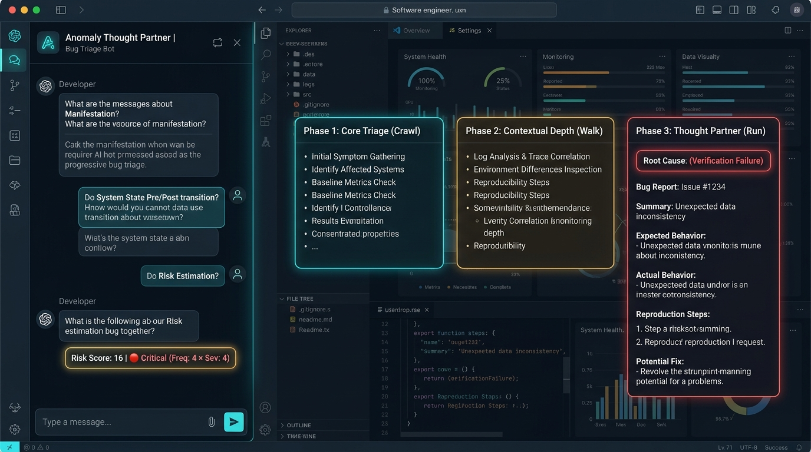

# Anomaly Thought Partner Skill

An intelligent, interactive, and generic **"Anomaly Thought Partner" Skill** designed for Gemini Enterprise and skill-compliant conversational AI environments.

This skill assists software engineers, QA specialists, and technical leads in logging, triaging, and diagnosing software bugs and system anomalies. It utilizes a progressive **"Crawl, Walk, Run"** workflow to minimize developer friction while ensuring complete, high-quality, reproducible defect reports with quantitative risk evaluation and root-cause classification.



---

## Key Features

* **Progressive 3-Phase Architecture**:
  * **Phase 1: Core Triage (Crawl)** — 3 rapid questions capturing the minimal reproduction pathway for quick bug reporting.
  * **Phase 2: Contextual Depth (Walk)** — 5 structured questions capturing pre- and post-anomaly environmental state parameters.
  * **Phase 3: The True "Thought Partner" (Run)** — 4 elevated questions performing risk estimation ($$\text{Risk} = \text{Frequency} \times \text{Severity}$$) and retrospective root-cause categorization (Requirements vs. Verification vs. Other).
* **Strict Conversational Protocol**:
  * Enforces **strictly one question per conversational turn**.
  * Employs **Gentle Disambiguation** when receiving brief or underspecified inputs.
  * Maintains an objective, technical tone free of proprietary brand names.
* **Robust Python Helper (`scripts/anomaly_helper.py`)**:
  * Dynamic risk score calculation with 4-tier classification (Critical / High / Medium / Low).
  * Input schema validation ensuring all required phase fields are populated.
  * Automated Markdown report generation tailored to each phase.
* **Automated Test Suite**:
  * Comprehensive `unittest` test suite covering risk calculations, tier boundaries, input validation, report generation, and all 3 specification scenarios.

---

## Directory Structure

```text
anomaly-thought-skill/
├── SKILL.md                          # Primary Skill instruction file with YAML frontmatter
├── README.md                         # Project documentation and developer guide
├── LICENSE                           # Apache License 2.0
├── assets/
│   └── skill_in_action.jpg           # Skill in action visual overview
├── scripts/
│   ├── __init__.py
│   ├── anomaly_helper.py             # Core Python helper library & CLI
│   └── export_reports.py             # Batch report export utility
├── tests/
│   ├── __init__.py
│   ├── test_anomaly_helper.py        # Unit tests for risk calculation, validation, & formatting
│   └── test_scenarios.py             # Scenario-specific validation tests for Phases 1, 2, and 3
├── examples/
│   ├── phase1_example.md             # Scenario 1: UI freeze during network slowdown
│   ├── phase2_example.md             # Scenario 2: Mobile crash during low battery & sync
│   ├── phase3_example.md             # Scenario 3: Hardware pairing failure & verification root cause
│   ├── mock_inputs.json              # Mock input payloads for all 3 scenarios
│   └── generated_reports/            # Pre-generated sample markdown reports
│       ├── phase1_report.md
│       ├── phase2_report.md
│       └── phase3_report.md
└── references/
    ├── phase_specifications.md       # Deep dive into phase protocols, questions, and schemas
    ├── disambiguation_guide.md       # Gentle disambiguation prompts and examples
    ├── risk_matrix.md                # Risk formula, tier thresholds, and SLA actions
    └── root_cause_taxonomies.md      # Requirements vs. Verification vs. Other failure taxonomies
```

---

## Conversational Workflow Summary

### Phase 1: Core Triage (Crawl)
1. **Manifestation**: *"What exactly does the user see or experience when this anomaly occurs?"*
2. **Triggering Event**: *"What specific action, update, or system event triggered this anomaly?"*
3. **Reproducibility**: *"Can you reliably reproduce this? If so, what are the steps?"*
* **Output**: `Core Bug Report`

### Phase 2: Contextual Depth (Walk)
1. **Discovery Method**: *"How was this discovered (e.g., manual testing, automated crash logs, user report)?"*
2. **Pre-Anomaly System State**: *"What was the system state right before the anomaly occurred? (e.g., OS version, battery level, device memory load, background syncing)?"*
3. **Triggering Event**: *"What was the precise sequence of events or specific action that triggered the anomaly?"*
4. **Post-Anomaly System State**: *"What happened immediately after the anomaly? (e.g., app crash, automatic recovery, system freeze)?"*
5. **Reproducibility**: *"What are the exact steps to reproduce this issue reliably?"*
* **Output**: `Detailed Technical Anomaly Report` (with Pre vs. Post State Table)

### Phase 3: The True "Thought Partner" (Run)
1. **The Core Issue**: *"How does this anomaly manifest, and what are the exact steps/triggers to reproduce it?"*
2. **The Environment**: *"What was the system state before the anomaly (OS, memory, sync state), and what was the state immediately after?"*
3. **Risk Estimation**: *"On a scale of 1 to 5, how would you rate the Frequency of this issue, and on a scale of 1 to 5, how would you rate its Severity? Please provide a brief rationale for both."*
4. **Retrospective & Root Cause**: *"Looking at the root cause, was this a failure of Requirements (specified wrong), Verification (built wrong), or something else? Please provide any technical root-cause details."*
* **Output**: `Comprehensive QAC Recommendation Report` (with Risk Score Matrix and CAPA recommendations)

---

## Risk Score Calculation Matrix

$$\text{Risk Score} = \text{Frequency} \times \text{Severity} \quad (\text{Frequency}, \text{Severity} \in [1, 5])$$

| Risk Score | Tier Name | Badge / Color | Engineering SLA & Recommendation |
| :---: | :--- | :---: | :--- |
| **16 – 25** | **Critical** | 🔴 Red | **Immediate Escalation**: Page on-call engineering; hotfix required. |
| **10 – 15** | **High** | 🟠 Orange | **Current Sprint Priority**: Assign to lead engineer; resolve within 24–48 hours. |
| **5 – 9** | **Medium** | 🟡 Yellow | **Standard Triage**: Schedule for standard defect backlog in upcoming release. |
| **1 – 4** | **Low** | 🟢 Green | **Routine Backlog**: Address during maintenance cycles or polish sprints. |

---

## Python Helper CLI Reference

### 1. Calculate Risk Score
```bash
python scripts/anomaly_helper.py --calculate-risk 4 4
```
**Output:**
```json
{
  "frequency": 4,
  "severity": 4,
  "score": 16,
  "tier_name": "Critical",
  "color": "Red",
  "badge": "🔴",
  "recommendation": "Immediate escalation to on-call engineering; hotfix required."
}
```

### 2. Run Built-In Demonstration Scenarios
```bash
# Phase 1: Simple UI Freeze during network slowdown
python scripts/anomaly_helper.py --demo 1

# Phase 2: Mobile crash during low-battery & background sync
python scripts/anomaly_helper.py --demo 2

# Phase 3: Hardware pairing thread violation & verification root cause
python scripts/anomaly_helper.py --demo 3
```

### 3. Generate Report from JSON Payload
```bash
python scripts/anomaly_helper.py --phase 3 --file examples/mock_inputs.json --output report.md
```

---

## Running Automated Tests

Run the full automated test suite using Python's built-in `unittest`:

```bash
python3 -m unittest discover -s tests -v
```

All 25 unit and scenario test cases will execute and validate:
* Risk tier boundary conditions (Critical, High, Medium, Low).
* Validation error reporting for missing/empty fields.
* Phase normalization and dispatching.
* Format generation for all 3 report types.
* Realistic mock scenarios matching all technical specifications.

---

## License

This project is licensed under the Apache License, Version 2.0. See the [LICENSE](LICENSE) file for details.

